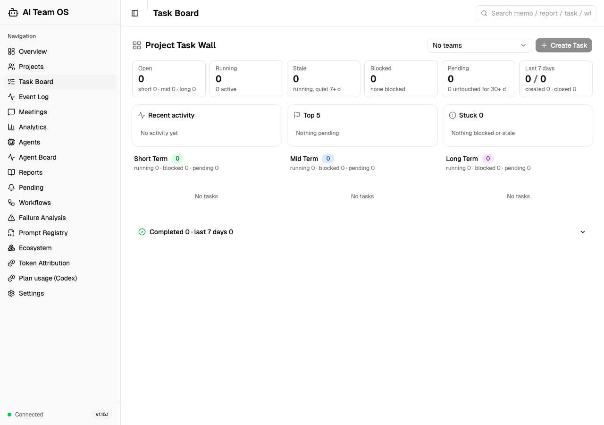
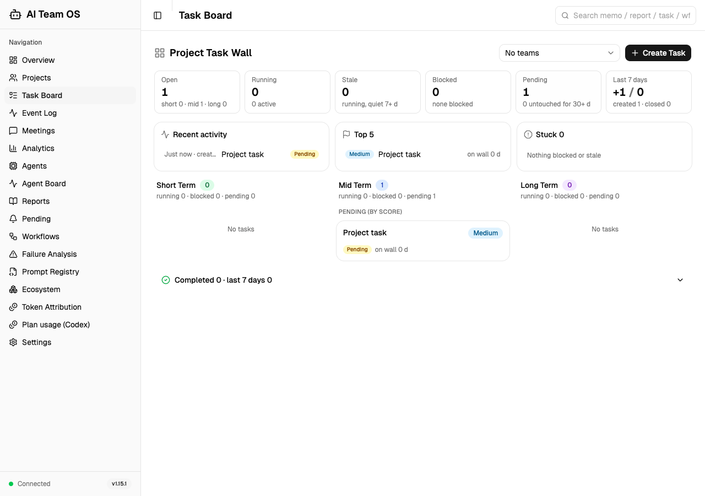

# 无团队项目创建任务：验收报告

## 问题与修复

关联 issue：[#7](https://github.com/CronusL-1141/AI-company/issues/7)。

项目任务墙要求项目至少有一个团队才启用创建按钮；提交又默认选择第一个团队。后端已有独立的项目任务接口，但前端未使用。

修复后，选中项目即可登记待办。默认不分配团队，使用 `POST /api/projects/{project_id}/tasks`；显式选择团队时使用现有 `POST /api/teams/{team_id}/tasks/run`。一个或多个团队都可选择。成功后主动刷新当前项目任务墙，接口失败时保留表单并展示错误。原有 `useRunTask` 保留，供项目详情页和团队详情页使用。没有数据库迁移或后端行为变更。

## 验证环境与边界

- 日期：2026-10-11。
- 基线：上游 master `3275b8a`（v1.15.1）；用户最初在运行中的 v1.15.0 发现问题。
- macOS、Python 3.14.5、Node 24.16.0、Chrome / Playwright，1280 × 900。
- 使用独立 API 端口和新建的临时 SQLite 数据库，成功创建、查询和任务墙刷新全部经过真实接口与生产校验。
- 测试装配不启动宿主 Hook、用量采集或后台巡检；没有改写用户数据库、账号设置或现有服务。
- 仅语言设置响应固定为英文，以及一次 POST 故障响应注入 HTTP 500。成功的任务请求没有 mock。
- 页面刷新会回到默认项目，验收重新选择原项目后检查任务；本修复不改变项目选择的持久化策略。

## 浏览器验收

| 场景 | 实际结果 |
|---|---|
| 无团队项目的创建按钮 | 可点击并打开表单 |
| 标题只有空格 | 提交按钮禁用，项目任务数仍为 0 |
| 无团队项目创建 | 返回 201，任务立即出现在任务墙；独立 GET 确认 `team_id=null`、项目 ID、去除首尾空格后的标题与描述正确 |
| 刷新页面 | 重新选择原项目后任务仍在 |
| 项目切换 | 原项目任务不出现在其他项目 |
| 有团队但未选择团队 | 仍创建项目任务，`team_id=null` |
| 显式选择团队 | 使用团队接口；独立 GET 确认团队 ID 和项目 ID 正确 |
| 接口故障与重试 | 显示错误，标题与描述保留；撤销故障注入后重试成功 |
| 项目仅有一个团队 | 团队选择器可用，保存后的团队和项目归属正确 |
| 执行边界 | 任务保持 `pending`；测试团队没有创建任何 Agent |

上述行为合并为 8 项浏览器检查，全部通过。修复前在真实页面得到预期断言失败：`Project without teams must allow task creation`，实际 `false`、预期 `true`。同一脚本修复后通过。

修复前：



修复后（页面重载并重新选择项目）：



## 工程检查

- `npm test`：143 项通过，无失败。
- `npm run build`：通过 TypeScript 检查与 Vite 构建；保留原有大 bundle 警告。
- `npm run lint`：无错误；既有 `AgentLivePage`、`ProjectDetailPage` 两条 Hook 依赖警告。
- `bash scripts/check_invariants.sh`：26 项红线全部通过，既有 warning 如实保留。
- 源码基线重建的 JS bundle 名称与已提交分发产物一致；本次构建后同步 `plugin/dashboard-dist`，避免分发旧页面。
- `python3 -m pytest tests/ -n 6 --dist loadfile`：7759 项通过、4 项跳过、92 条 warning，194.43 秒，无失败。

本机初始缺少测试/可选运行依赖，隔离子进程也读不到仅安装在用户目录的 PyYAML。补齐系统解释器依赖后重新验证；环境问题不计为修复通过证据。

## 复跑

从仓库根目录安装项目和测试依赖后：

```sh
cd dashboard
npm ci
npm run build
npm test
npm run lint
# 使用已有 Playwright 与 Chrome；不自动下载浏览器。
PLAYWRIGHT_MODULE_PATH=/absolute/path/to/playwright/index.js npm run test:tasks:browser
cd ..
python3 -m pytest tests/ -n 6 --dist loadfile
bash scripts/check_invariants.sh
```

浏览器脚本默认使用端口 18082；可用 `TASK_ACCEPTANCE_PORT` 指定空闲端口。`DASHBOARD_ACCEPTANCE_OUTPUT` 可指定截图、服务日志及 JSON 结果目录；未设置时使用临时目录。数据库每次新建，脚本结束后停止自己创建的测试服务。

## 交付边界

此报告验证修复分支；用户原有 8000 服务没有被重启或替换。PR 合并、发布及本机安装更新不包含在此次验收中。
